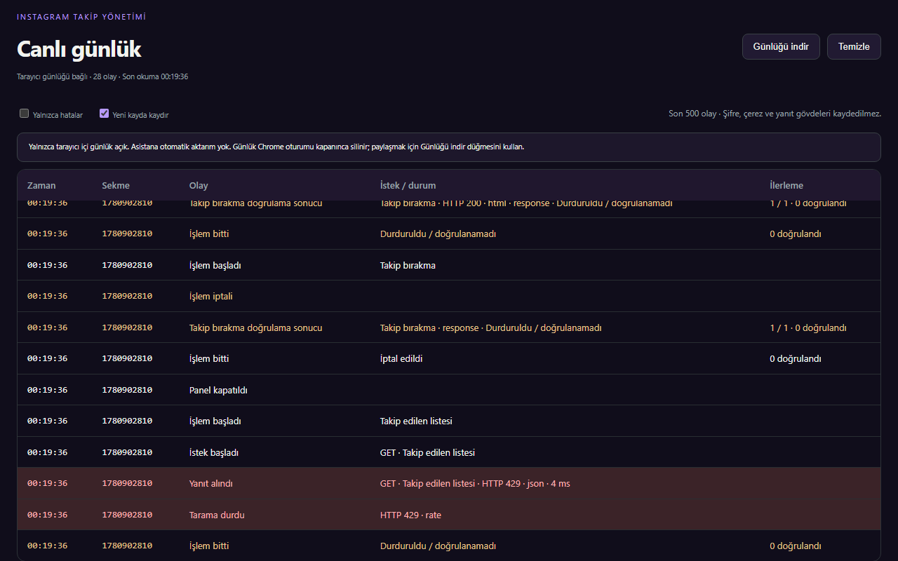

# Takip Paneli

Instagram takip listesini lila bir dashboard üzerinden yönetmek için Chrome Manifest V3 eklentisi. Türkçe ve İngilizce arayüz sunar.


## İndir

**[Hazır ZIP dosyalarını Releases sayfasından indir](https://github.com/Bluetwinklez/unfollow-instagram-dashboard/releases/latest).**

| Dosya | İçerik |
|---|---|
| `takip-paneli-chrome-2.8.8.zip` | Chrome'a kurulacak hazır eklenti; derleme gerekmez. |
| `takip-paneli-source-2.8.8.zip` | Kaynak kod, testler, belgeler ve derleme betikleri. |
| `SHA256SUMS.txt` | İki ZIP'in SHA-256 doğrulama değerleri. |

Bu sürüm GitHub üzerinden dağıtılır. Chrome Web Mağazası'nda henüz yayınlanmadı. Önceki gerçek hesapta görülen “unexpected response” hatasının çözüldüğü canlı kullanımda henüz doğrulanmadı.

## Chrome'a kurulum

1. **takip-paneli-chrome-2.8.8.zip** dosyasını indir.
2. ZIP'e sağ tıklayıp **Tümünü ayıkla** ile kalıcı bir klasöre çıkar.
3. Chrome adres çubuğuna `chrome://extensions` yaz.
4. Sağ üstten **Geliştirici modu** seçeneğini aç.
5. **Paketlenmemiş öğe yükle** düğmesine bas. İçinde doğrudan **manifest.json** bulunan çıkardığın klasörü seç.
6. [Instagram](https://www.instagram.com/) üzerinde hesabına giriş yap. Uzantılar menüsünden **Instagram Takip Yönetimi** simgesine tıkla. Kısayol: `Ctrl+Shift+Y`.

**Manifest dosyası eksik veya okunamıyor:** ZIP'i önce çıkar. ZIP dosyasını veya Chrome profil klasörünü değil, `manifest.json` dosyasının bulunduğu klasörü seç. Kaynak ZIP'ini indirdiysen yüklenecek klasör **extension/** olur. Kurulum klasörünü sonradan silme veya taşıma.

### Güncelleme

Devam eden işlemi bitir veya iptal et. Yeni ZIP'in içeriğini mevcut kurulum klasörüne çıkarıp dosyaları değiştir. Uzantılar sayfasında eklentinin **Yeniden yükle** düğmesine bas ve Instagram sekmesini yenile.

## Kullanım

1. **Tüm takip ettiklerim** veya **Beni geri takip etmeyenler** seçeneğini belirle.
2. Taramayı başlat. İkinci seçenek iki listeyi karşılaştırır; eksik taramada sonuçlar ve takip bırakma açılmaz.
3. İsim veya kullanıcı adıyla ara; hesapları tek tek ya da tümünü seç. Arama dışında kalan seçimler temizlenir.
4. Takip bırakma düğmesine basıp seçili hesap sayısını kontrol ederek onayla. Önce tek hesapla çalışmayı doğrula.
5. İstediğinde duraklat, devam et veya iptal et. İptal, daha önce tamamlanan takip bırakmalarını geri almaz.

Varsayılan süreler: işlemler arasında **4–4,8 saniye**, her **5 işlemde 5 dakika mola**. Bağımsız doğrulama toplam süreyi uzatır. Süreleri ayarlardan değiştirebilirsin; hiçbir süre Instagram kısıtlamalarını önleme garantisi vermez.


## Özellikler

- Lila dashboard, Türkçe/İngilizce arayüz ve farklı ekranlara uyum.
- İsteğe bağlı iki tarama: tüm takip edilenler veya geri takip etmeyenler.
- Arama, tekli/toplu seçim, kopyalama ve profil bağlantıları.
- Açık onay, duraklatma, devam etme ve iptal.
- İşlemden sonra bağımsız takip durumu doğrulaması; belirsiz yanıt başarı sayılmaz.
- Yarım taramaya devam etme, hesap değişimi kontrolü ve sekmeler arası işlem kilidi.
- Yerel canlı günlük, JSON rapor indirme, güncel küçültülmüş gösterge ve klavye erişimi.

## Hatalar ve canlı günlük



Panelin üstündeki **Canlı günlük (≡)** düğmesi kayıt ekranını açar. Tarama hataları ve her takip bırakmanın doğrulama sonucu anlık eklenir. Günlük son 500 olayı tutar; Chrome oturumu kapatılınca silinir. İndirdiğin JSON dosyaları cihazında kalır. Okuma/temizleme hataları ekranda belirtilir; kayıt ekranı 5 saniyede bir bağlantısını yeniden kontrol eder.

**Asistana otomatik canlı aktarım bu hazır ZIP’te yoktur.** İnceleme için Günlüğü indir ile dosyayı paylaşabilirsin. Kaynak koddaki isteğe bağlı yerel yardımcı ayrı kurulum gerektirir; Releases eklenti paketine dahil değildir.

Bir işlem belirsiz yanıt verdiğinde başarılı sayılmaz. **Rapor indir / Download report** ile JSON raporunu kaydet. Raporda sürüm, işlem sonucu ve mevcut olduğunda HTTP durumu ile yanıt türü bulunur.

Canlı günlük tarayıcıda tutulur. Bu paket günlükleri geliştiriciye veya asistana otomatik göndermez; inceleme için raporu kendin paylaşmalısın. Oturum süresi dolarsa yeniden giriş yap. Liste kısıtlaması veya istek sınırı görülürse art arda tekrar başlatma.

## Gizlilik ve izinler

Hazır eklenti yalnızca `activeTab`, `scripting` ve `storage` izinlerini ister. Instagram sekmesindeki mevcut oturumla çalışır. Ayarlar, ilerleme ve günlükler yerel tutulur; geliştirici sunucusuna aktarılmaz. Hazır paket Python, yerel log sunucusu veya uzaktan kontrol bağlantısı içermez.

Chrome Web Mağazası gereksinimleri için canlı HTTPS [Gizlilik Politikası (GitHub Pages)](https://bluetwinklez.github.io/unfollow-instagram-dashboard/privacy.html) hazırlanmıştır. Mağaza yayın otomasyonu için [Chrome Web Store Otomasyon Rehberi](docs/CHROME-WEB-STORE-OTOMASYON.md) belgesini inceleyin.

## Geliştirme ve test

Gereksinimler: **Node.js 24**, **Python 3** ve Playwright Chromium.

```sh
git clone https://github.com/Bluetwinklez/unfollow-instagram-dashboard.git
cd unfollow-instagram-dashboard
npm ci
npx playwright install chromium
npm run build
npm test
```

Linux'ta `npx playwright install --with-deps chromium` kullanılır. Hızlı kontroller: `npm run test:unit`. Tarayıcı kontrolleri: `npm run test:browser`.

Testler ayrı tarayıcı profilleri ve taklit Instagram yanıtları kullanır; gerçek hesabında takip bırakmaz. Önceki doğrulama **16/16 test paketi ve 28/28 tarayıcı özellik grubunu** kapsar. [Test raporu](docs/TEST-REPORT.md) ve [GitHub Actions](https://github.com/Bluetwinklez/unfollow-instagram-dashboard/actions) sonuçlarına bakabilirsin. Gerçek hesap başarısı henüz doğrulanmadı.

## Yayın paketi hazırlama

Derleme ve testler geçtikten sonra değişiklikleri Git’e commit et; ardından `python scripts/package-release.py` çalıştır. Betik sürüm/test durumunu, izinleri ve paket dosyalarını denetleyip kurulabilir ZIP, kaynak ZIP ve SHA-256 listesi üretir.

### Chrome Web Store Otomasyonu (GitHub Actions)

Depodaki `.github/workflows/cws-publish.yml` iş akışı sayesinde `v*` etiketi oluşturulduğunda veya GitHub Actions arayüzünden tek tıkla eklenti Chrome Web Mağazası'na otomatik yüklenir.

- **Tek Seferlik Kurulum:** [Chrome Web Store Otomasyon Rehberi](docs/CHROME-WEB-STORE-OTOMASYON.md)
- **Hızlı OAuth Token:** `npm run auth:cws`
- **Canlı Gizlilik Sayfası:** `https://bluetwinklez.github.io/unfollow-instagram-dashboard/privacy.html`

## Kaynak ve yayın durumu

Üçüncü taraf başlangıç kodunun atıfları [THIRD_PARTY_NOTICES.md](THIRD_PARTY_NOTICES.md) içinde korunur. Orijinal kaynağın yeniden dağıtım izni henüz doğrulanmadı; bu depo yeni bir dağıtım lisansı vermez. Ayrıntılar: [LICENSE-NOTICE.md](LICENSE-NOTICE.md).

Görseller örnek hesaplarla hazırlanmıştır. Instagram veya Meta ile bağlantılı değildir. [Yayın kontrol listesi](RELEASE-CHECKLIST.md) mağaza ve gerçek hesap doğrulaması için kalan işleri içerir.
