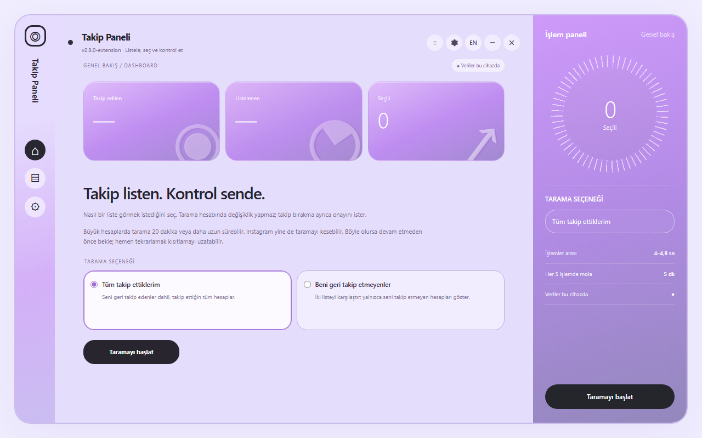
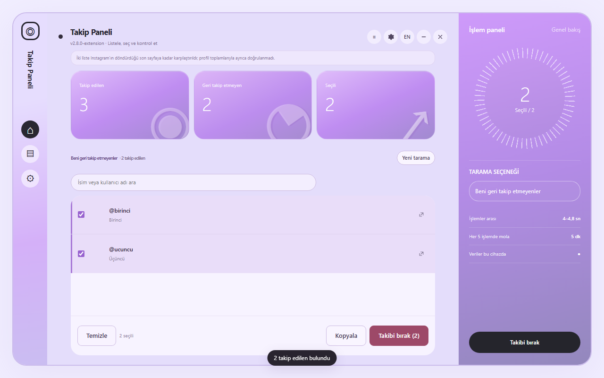

# Takip Paneli

Açık lila dashboard tasarımlı Chrome Manifest V3 eklentisi.



## Özellikler

- İsteğe bağlı iki tarama: tüm takip ettiklerin veya seni geri takip etmeyenler.
- İki liste tamamlanmadan geri takip etmeyenler sonucu açılmaz.
- Arama, tek tek/tümünü seçme, kopyalama ve profil bağlantıları.
- Açık onay, duraklatma, iptal ve bağımsız takip durumu doğrulaması.
- Yarım taramaya devam etme ve sekmeler arası işlem kilidi.
- Yerel canlı günlük ve ayrıntılı JSON işlem raporu.
- Türkçe/İngilizce arayüz, mobil genişlik ve klavye erişimi.



Görseller örnek hesaplarla üretilmiştir. Gerçek hesap başarısı veya kısıtlanmama garantisi değildir.

## Kurulum

1. Depoyu indir.
2. Chrome'da chrome://extensions sayfasını aç ve geliştirici modunu etkinleştir.
3. Paketlenmemiş öğe yükle ile **extension/** klasörünü seç.
4. www.instagram.com üzerinde eklenti simgesine tıkla. Tarama seçeneğini belirleyip başlat.
5. Takip bırakmadan önce bir hesapla dene; seçim ve onay gereklidir.

Mağaza sürümünün Python veya yerel sunucuya ihtiyacı yoktur. Ayarlar ve ilerleme tarayıcıda kalır. Instagram'a oturumlu istekler gönderilir; geliştirici sunucusuna veri aktarılmaz.

## Geliştirme ve test

Node.js 24 ve Python 3 kullanılır.

```sh
npm ci
npx playwright install chromium
npm run build
npm test
```

Linux'ta tarayıcı bağımlılıkları için npx playwright install --with-deps chromium kullanılır. Testler ayrı tarayıcı profilleri açar ve Instagram ağ isteklerini taklit eder; gerçek hesabı kullanmaz. Sonuçlar instagram-magaza-hazirlik/TUM-OZELLIK-TESTLERI.md dosyasına yazılır.

Varsayılan hızlar: kişiler arasında 4–4,8 saniye, her 5 işlemde 5 dakika mola. Bağımsız doğrulama ayrıca zaman alır. Süreler kısıtlama olmamasını garanti etmez.

## GitHub'a yükleme

Bu klasör yerel bir Git deposu olarak hazırlanmıştır. GitHub'da boş depo oluşturduktan sonra:

```sh
git add .
git commit -m "Prepare following dashboard 2.8.0"
git remote add origin REPOSITORY_URL
git push -u origin main
```

REPOSITORY_URL yerine kendi deponun adresini yaz. Uzak depo: https://github.com/Bluetwinklez/unfollow-instagram-dashboard

## Yayın durumu ve kaynak atfı

Bu uyarlama üçüncü taraf başlangıç kodu içerir; kaynak atfı THIRD_PARTY_NOTICES.md içinde korunur. Kaynak projenin yeniden dağıtım lisansı doğrulanmadığından dağıtım izni durumu ayrıca tamamlanmalıdır. Bu klasör yeni bir dağıtım lisansı vermez. Arayüzde kişisel imza veya watermark bulunmaz; tasarım referansı Krea ile üretilmiştir.

Mağaza gizlilik taslağındaki yayıncı bilgileri ve herkese açık URL doldurulmalıdır. Chrome Web Mağazası'na gönderim yapılmadı. Instagram / Meta ile bağlantılı değildir.
