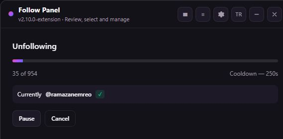
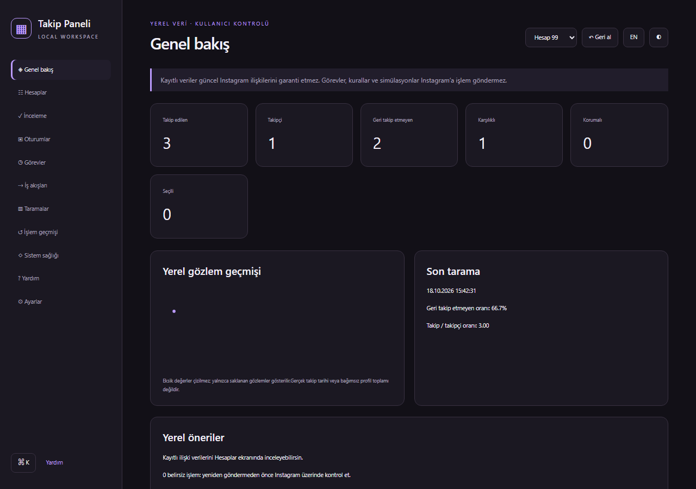
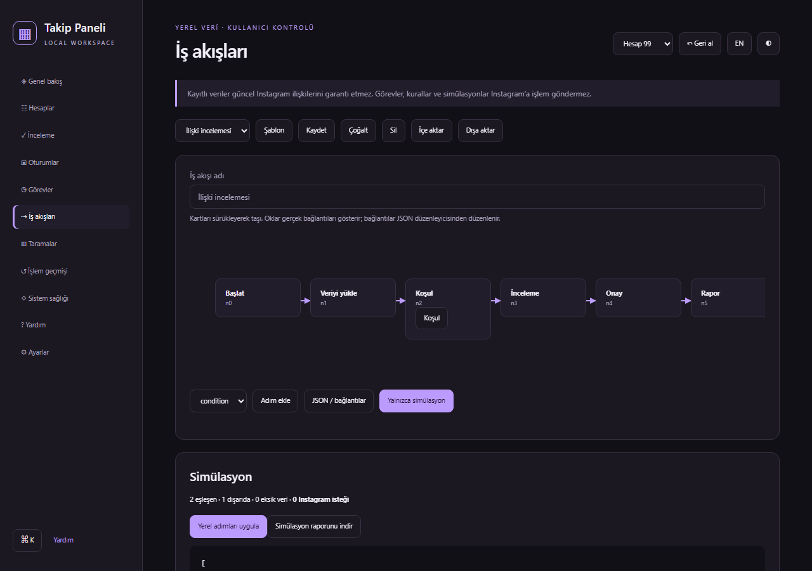
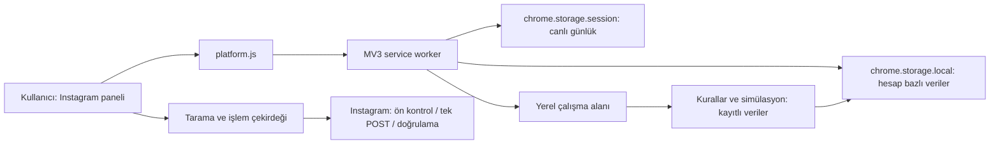
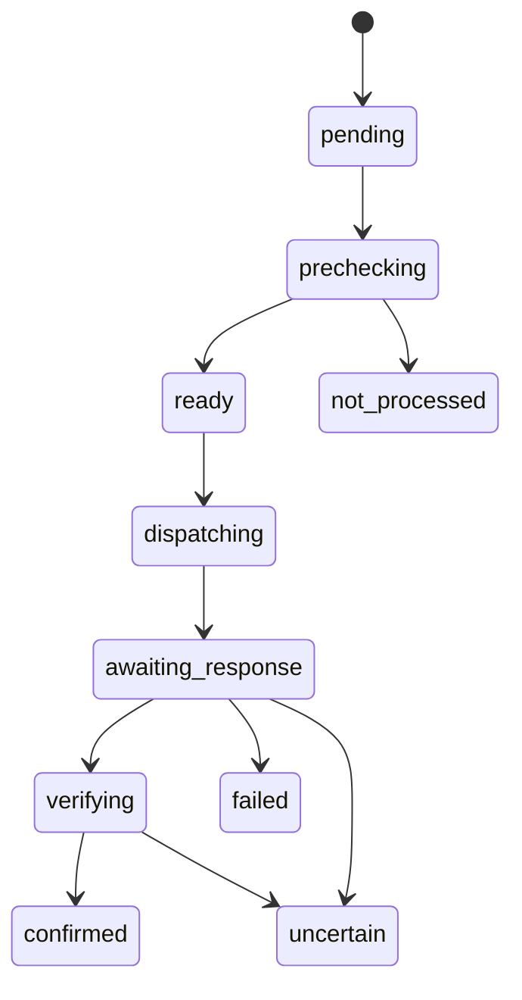

# Takip Paneli

Instagram takip listesini incelemek, korunan hesapları ayırmak ve yerel bir çalışma alanında düzenlemek için Chrome Manifest V3 eklentisi. Türkçe/İngilizce, mor/koyu ve açık tema içerir.

**Güncel sürüm: 2.10.0.**

**19 Ekim 2026 güncellemesi:** Polaris takip bırakma akışı, ayrıntılı ve filtrelenmiş ağ günlüğü, ek profil isteği olmadan sayfa oturum kimliği kontrolü ve uzun onay listesi için kaydırma düzeltmesi eklendi. Kullanıcı takip bırakma başarı bildirimi gördüğünü bildirdi; bağımsız gerçek hesap raporuyla kabul henüz tamamlanmadı. GitHub Actions üzerinde **26/26** paket geçti; test parmak izleri kaynakla eşleşiyor. Yerel Windows koşusunda beş tarayıcı paketi `spawn UNKNOWN` nedeniyle başlatılamamıştı. [CI kanıtı](docs/repair/CI-VERIFICATION.json). [Protokol kanıtı ve sınırlar](docs/repair/POLARIS-UNFOLLOW-EVIDENCE.md), [ayrıntılı günlük](docs/repair/DETAILED-LOGGING.md).

**Durum:** Onarım ve yerel çalışma alanı geliştirmeleri otomatik testlerle doğrulanır. Gerçek Instagram hesabında uçtan uca takip bırakmanın düzeldiği henüz kanıtlanmadı. Instagram'ın özel uç noktaları değişebilir; HTML veya HTTP 200 tek başına başarı değildir. Mağaza onayı ve kaynak yeniden dağıtım izni ayrıca tamamlanmalıdır.



19 Ekim 2026'da açık eklenti ekranından alınmıştır: 35/954 ilerlemesi, mola sayacı ve duraklat/iptal kontrolleri.



## İndirme ve doğru klasör

**[Chrome Web Store'da aç ve Chrome'a ekle](https://chromewebstore.google.com/detail/instagram-takip-y%C3%B6netimi/fiakfpibolpneohdkfejlggbklegiced)**

Mağazadan kurulum için yukarıdaki bağlantıyı kullan. ZIP ile elle kurulum için:

[2.10.0 sürümü](https://github.com/Bluetwinklez/unfollow-instagram-dashboard/releases/tag/v2.10.0) dosyalarını kullan:

| Dosya | Ne işe yarar? |
|---|---|
| `takip-paneli-chrome-SÜRÜM.zip` | Kurulabilir eklenti. Derleme gerekmez. |
| `takip-paneli-source-SÜRÜM.zip` | Kaynak kod, testler, belgeler ve derleme araçları. |
| `SHA256SUMS.txt` | ZIP dosyalarını karşılaştırmak için SHA-256 değerleri. |

1. Chrome ZIP'ini indir, sağ tık → **Tümünü ayıkla**.
2. `chrome://extensions` adresini aç; **Geliştirici modu** seçeneğini aç.
3. **Paketlenmemiş öğe yükle** düğmesinden içinde doğrudan `manifest.json` bulunan klasörü seç.
4. Instagram'a giriş yap. Uzantılar menüsünden eklentiyi aç veya `Ctrl+Shift+Y` kullan.
5. **▦ Çalışma alanı** düğmesi yerel dashboard'ı açar. Tamamlanan taramalar burada hesap bazında saklanır.

“Manifest dosyası eksik” hatası: ZIP dosyasını, Chrome profilini veya dıştaki boş klasörü seçme. Kaynak ZIP'ini indirdiysen `extension/` klasörünü seç. Kurulum klasörünü sonradan taşıma/silme.

**Güncelleme:** Çalışan işlemi bitir/iptal et, yerel verinin yedeğini indir, yeni ZIP'i mevcut klasöre çıkar. Uzantılar sayfasında **Yeniden yükle**, ardından Instagram sekmesini yenile. Eklentiyi kaldırıp kurmak yerel verileri silebilir.

## Tarama ve takip yönetimi

- **Tüm takip ettiklerim:** Takip edilen listeyi yükler. Takipçi listesi okunmadığından geri takip bilgisi bilinmiyor olarak kalır.
- **Beni geri takip etmeyenler:** İki listeyi karşılaştırır. Eksik taramada doğrulanmış sonuç ve takip bırakma açılmaz.
- İsim/kullanıcı adıyla ara, seçim yap ve sayılarını kontrol et. Arama dışında kalan seçimlerin davranışı ekranda belirtilir.
- Takip bırakma, kullanıcı onayından sonra başlar. Korunanlar seçilemez ve gönderimden hemen önce yeniden kontrol edilir.
- Duraklat/devam/iptal kullanılabilir. İptal, sunucuya ulaşmış isteği geri alamaz; sonucu belirsiz kalan kayıt otomatik tekrarlanmaz.

Varsayılan işlem aralığı **4–4,8 saniye**, her **5 işlemde 5 dakika mola**. Ön kontrol ve bağımsız doğrulama ayrıca süre alır. Hiçbir bekleme süresi kısıtlanmama garantisi vermez.

### Bir hesabın işlem akışı

1. Hesap kimliği, oturum, sekme sahipliği, seçim ve koruma kontrol edilir.
2. Güncel ilişki okunur. Zaten takip edilmeyen hesap için POST gönderilmez ve yeni başarı yazılmaz.
3. İşlem niyeti yerel depoya yazılıp kalıcılığı beklenir; yazılamazsa gönderim yapılmaz.
4. Tek POST gönderilir. Yanıt türü, HTTP durumu ve JSON şeması değerlendirilir.
5. Ayrı GET ile `following: false` doğrulanmadan yeni başarı sayılmaz.
6. Ağ/HTML/belirsiz doğrulamada kuyruk durur. Aynı belirsiz kayıt taze tarama olmadan otomatik gönderilmez.

| Sonuç | Anlamı |
|---|---|
| Doğrulandı | Önceden takip ediliyordu; gönderimden sonra takip edilmediği okundu. |
| Başarısız | Kesin ret/hata alındı. |
| Belirsiz | Gönderim sonucu veya sonraki doğrulama kesin değil. Başarı değildir. |
| İşlenmedi | İstek gönderilmedi; ör. iptal, koruma, ön kontrol hatası veya zaten takip edilmiyor. |

Rapor bu dört grubu ayrı tutar. Sıfır doğrulanmış işlem “hepsi başarıyla tamamlandı” olarak gösterilmez. “Hatada devam” seçeneği belirsizlik, oturum, oran sınırı veya güvenlik duruşlarını aşamaz.

## Yerel çalışma alanı

Dashboard, kaydedilmiş taramalar üzerinde çalışır. İş akışı ve görev ekranları Instagram'da arka planda toplu işlem başlatmaz.

| Ekran | Özellikler |
|---|---|
| Genel bakış | Gerçek kayıtlardan istatistik, tarih aralığı ve metrik seçimiyle geçmiş grafiği. Eksik veri sıfır gibi gösterilmez. |
| Hesaplar | Vurgulu arama, ok tuşlarıyla gezinme, sıralama, form veya gelişmiş JSON ile filtre düzenleme, 200 satırlık sayfalama; görünen/tüm eşleşen seçim, ters seçim, kayıtlı seçimler. |
| Koruma | Hesabı işlemden hariç tutma, favori, etiket ve not; koruma listesini JSON aktarma/içe alma. |
| İnceleme | Yerel inceleme kuyruğu, gözden geçirildi/atla/koru ve not ekleme. |
| Oturumlar | Kaynak tarama, seçilen kimlikler, ilerleme ve notları kaydetme; devam/arşivleme. Otomatik POST devamı yok. |
| Görevler | Öncelik, son tarih, erteleme, tamamla/arşivle. Uygulama açıkken yerel hatırlatma. |
| İş akışları | Altı hazır şablon, sürüklenen düğümler, Çıkış → Giriş ile görsel bağlantılar, basit kural formu ve gelişmiş JSON; AND/OR/NOT, öncelik/çatışma, döngü kontrolü. |
| Simülasyon | Kayıtlı veri üzerinde sıfır Instagram isteğiyle değerlendirme. Yerel inceleme/bildirim/rapor etkileri ayrı onayla uygulanır. |
| Geçmiş | Tarama karşılaştırması ve işlem geçmişi; kullanıcı adı değişse de kimlikle eşleştirme. Listede görünmemek, kasıtlı takip bırakma kanıtı değildir. |
| Sağlık/destek | Depolama boyutu, sürüm, yerel worker bağlantısı, belirsiz kayıtlar, tanı sihirbazı ve alan seçmeli destek raporu. |
| Ayarlar/yardım | TR/EN, açık/koyu tema, kompakt görünüm, hareket azaltma, Ctrl+K/Ctrl+J komut paleti; başlangıç rehberi ve aranabilir yardım. |



Düğümler sürüklenerek yerleştirilir. Bağlantı eklemek için önce kaynak kartta Çıkış, sonra hedef kartta Giriş seç; bağlantı/adımları ayrı silebilirsin. Döngü reddedilir. Basit AND/OR koşulları formdan; iç içe gruplar, NOT ve öncelikli kural kümeleri gelişmiş JSON ile düzenlenir. Bilinmeyen profil niteliği kurallarda yanlışmış gibi değerlendirilmez. Deneysel öneriler yalnızca yerel veriyi kullanır; hesap riski veya takipçi niyeti tahmin etmez.

### Yedekleme, dışa aktarma ve geri alma

- Çalışma alanını JSON yedekle; hesap listelerini JSON/CSV/TXT olarak dışa aktar.
- CSV hücrelerinin elektronik tabloda formül olarak çalıştırılması engellenir.
- İçe alma öncesinde şema, kimlikler, boyut ve hesap uyumu denetlenir; önizleme ve açık onay gerekir.
- Son yerel hesap düzenlemesini **Geri al** ile geri alabilirsin. Instagram işlemleri geri alınmaz.
- Eşzamanlı iki pencerenin eski veri üzerine yazması revizyon kontrolüyle engellenir; tekrar yüklemek gerekebilir.
- Bozuk depolama otomatik sıfırlanmaz. Hata gösterilir; mevcut veri korunur. Kurtarma ekranı ham kaydı indirmeyi ve geçerli yedeği önizlemeyi sağlar; bozuk asıl kayıt karantinada saklanır. Ayarlar’dan bu kopyayı indirebilir veya açık onayla silebilirsin. Geçerli yedek olmadan kayıp veri yeniden üretilemez.

## Canlı günlük ve destek

Instagram panelindeki **≡ Canlı günlük** tarayıcı içi kayıtları açar. Son 500 olay Chrome oturumunda tutulur; oturum kapanınca silinir. İşlem günlüğü ve çalışma alanı geçmişi farklıdır: son 300 işlem kaydı yerel kalıcı depoda tutulur. Kesinleşmiş geçmiş temizlenebilir; belirsiz kayıtlar tekrar gönderim koruması için korunur. Etkin işlem varken geçmiş temizleme reddedilir.

**Hazır ZIP asistana otomatik canlı aktarım yapmaz.** Günlük/işlem raporunu indirip paylaşabilirsin. Destek raporunun önizlemesinde gereksiz alanları çıkar; not, kullanıcı listesi ve yedek dosyaları kişisel bilgi içerebilir. Ham yanıt gövdesi, çerez, CSRF ve erişim anahtarı rapora eklenmez.

Kaynakta bulunan isteğe bağlı Python yardımcısı ayrı özel kullanım içindir; mağaza ZIP'ine, izinlerine veya arka plan servislerine dahil değildir. Eklenti kullanıcı bilgisayarına otomatik izleme servisi kurmaz.

## Gizlilik ve depolama

Hazır paket yalnızca **activeTab, scripting, storage** izinlerini ister. Kalıcı host izni, uzaktan kod, geliştirici sunucusu, reklam veya analitik yoktur. Instagram işlemleri açık sekmedeki mevcut oturumu kullanır.

- Hesaplar sayısal Instagram kimliğine göre ayrılır; not/koruma ve seçim başka hesaba taşınmaz.
- Varsayılan saklama: hesap başına son 5 tarama; ayarlardan 1–20. Boyut sınırında eski taramalar azaltılır; son tarama korunur, kota dolarsa hata gösterilir.
- Tarama kontrol noktasının 24 saatlik geçerliliği vardır. Sürenin dolması verinin diskten kendiliğinden silindiği anlamına gelmez.
- Veriler Chrome profilindeki yerel depoda; indirilen yedek ve raporlar cihazındadır. Chrome profilinin güvenliği kullanıcıya bağlıdır.

[Gizlilik politikası](https://bluetwinklez.github.io/unfollow-instagram-dashboard/privacy.html) · [Paketle aynı metnin kaynağı](docs/privacy.html)

Instagram `x-ig-app-id` ve `x-asbd-id` değerleri herkese açık istemci tanımlayıcılarıdır; kişisel API anahtarı değildir. OAuth sırları, refresh token ve özel log yapılandırmaları Git'e/pakete konmaz. GitHub Actions sırları yalnızca Secrets üzerinden sağlanır.

## Sonradan tamamlanan ayrıntılar

- Genel Bakış ve Tarama Geçmişi aynı tarih/metrik kontrollerini kullanır.
- Onay ekranı seçilen, korumalı, önceden işlenen, belirsiz ve uygun hedefleri ayrı gösterir; son hedef listesi incelenebilir. Tahminî bitiş saati uydurulmaz.
- `/` arama, `S` görünenleri seç, `X` temizle, `R` inceleme, oklarla inceleme ve `P` yerel koruma. Metin yazarken devreye girmez; ek kısayollar Ayarlar'dan kapatılabilir.
- Varsayılan filtre, sıralama, dışa aktarma biçimi ve gösterilecek dashboard kartları hesap bazında saklanır.
- Şeffaf öneriler; son taramadaki ilişkilere, belirsiz işlem kayıtlarına, eski seçimlere, 30 günden eski taramalara ve açık keep/remove etiket çakışmasına dayanır. Değişiklikler önizleme/onay ister.
- Temizlik, tanı ve dışa aktarma hazırlığı şablonları ilgili yerel araçları açar. Kendi başlarına silme veya Instagram işlemi yapmaz.
- Krea 2 Medium ile üretilen mor dashboard illüstrasyonu pakette yerel saklanır; çalışma sırasında Krea'ya istek gönderilmez.

[İstek karşılaştırması ve kalan dış doğrulamalar](docs/repair/COMPLETION-AUDIT.md).

### Asistanın okuyabileceği özel yerel log

Mağaza paketinin tarayıcı günlüğü açıktır; otomatik dışarı aktarım yoktur. Özel geliştirme sürümündeki kimlik doğrulamalı yardımcı çalışıyor ve log üretiyorsa asistan bu komutla yalnızca güvenli özeti okuyabilir:

```sh
python scripts/live-log-monitor.py
python scripts/live-log-monitor.py --seconds 60
```

Araç olay/HTTP sayıları ve dosya tazeliği gösterir; ham yanıt, çerez, anahtar ve hesap adı göstermez. `--path` ile özel log konumu seçilebilir. Dosyanın yeni olması bağlantı veya başarılı takip bırakma kanıtı değildir. Yardımcı bağlı değilse açıkça `available: false` döner. Asistan kapalıyken kesintisiz izleme servisi kurulmuş değildir.

## Dosya ağacı

```text
unfollow-instagram-dashboard/
├── instagram-tum-takipleri-birak.js  # Ortak tarama/işlem çekirdeği
├── instagram-dashboard.css         # Instagram panelinin stili
├── extension/                      # Kurulabilir, özel yardımcı içermeyen MV3 paket
│   ├── manifest.json
│   ├── service-worker.js           # Sekme kilidi, günlük, yerel depolama
│   ├── platform.js                 # Chrome API köprüsü ve kimlik/sahiplik koruması
│   ├── content.js                  # Çekirdekten üretilen Instagram paneli
│   ├── workspace-art.png           # Yerel Krea illüstrasyonu
│   ├── workspace-core.js           # Saf veri, kurallar, şema ve simülasyon
│   ├── workspace.{html,css,js}      # Yerel dashboard
│   ├── logs.{html,css,js}           # Tarayıcı içi canlı günlük
│   ├── help.{html,css,js}           # Yardım
│   ├── privacy.html
│   ├── CREDITS.md
│   └── icons/
├── instagram-chrome-eklentisi/      # Özel geliştirme sürümü kaynakları
├── instagram-*.test.cjs             # Birim, güvenlik ve Chromium entegrasyon testleri
├── instagram-log-bridge.test.py     # İsteğe bağlı yerel yardımcı testleri
├── scripts/
│   ├── build-extension.cjs          # Çekirdeği paketler
│   ├── build-store.cjs              # Özel yardımcıyı çıkarır; temiz extension/ üretir
│   ├── test-all.cjs                 # Testleri ve dosya parmak izlerini kaydeder
│   ├── test-fingerprint.cjs         # Test edilen girdilerin SHA-256 özeti
│   ├── audit-release.cjs            # Hassas dosya, anahtar örüntüsü ve izin denetimi
│   ├── package-release.py          # Temiz ve test edilmiş revizyondan ZIP üretir
│   ├── live-log-monitor.py          # Özel yerel logun güvenli özeti
│   └── cws-auth-helper.mjs          # Yerel OAuth state + PKCE yardımcısı
├── docs/
│   ├── index.html                  # GitHub Pages
│   ├── privacy.html
│   ├── CHROME-WEB-STORE-OTOMASYON.md
│   ├── screenshots/
│   └── repair/                     # Başlangıç kanıtı, mimari, test ve sınırlar
├── .github/workflows/
│   ├── test.yml
│   ├── pages.yml
│   └── cws-publish.yml
├── RELEASE-CHECKLIST.md
├── LICENSE-NOTICE.md
├── package.json
└── package-lock.json
```

Derleme ayrıca Git dışında `instagram-magaza-hazirlik/` altında test raporlarını, mağaza kopyasını ve görselleri üretir. `node_modules`, yerel anahtarlar, `.env`, ham günlükler ve ZIP'ler kaynak ağacına dahil edilmez.

## Mimari





Şema kullanıcıya görünen sonuçları özetler; iç durum makinesinde gönderim öncesi iptal ayrıca `cancelled_before_dispatch` olarak kaydedilir. [Ayrıntılı teknik inceleme](docs/repair/ARCHITECTURE.md).

## Geliştirme ve test

Gereksinimler: Node.js 24, Python 3, Playwright Chromium. Otomatik testler yüklü Chrome'un kişisel profilini kullanmaz.

```sh
git clone https://github.com/Bluetwinklez/unfollow-instagram-dashboard.git
cd unfollow-instagram-dashboard
npm ci
npx playwright install chromium
npm run build
npm test
node scripts/audit-release.cjs
```

Test raporu `instagram-magaza-hazirlik/TUM-TEST-SONUCLARI.json` içine yazılır. Dosya parmak izleri test sırasında veya sonrasında değişirse paketleme durur. Kaynak değiştirildikten sonra tekrar build/test gerekir.

```sh
# İncelenen dosyaları commit ettikten sonra:
python scripts/package-release.py
```

Paketleyici temiz Git revizyonu, sürüm eşitliği, bütün test sonuçları, değişmeyen dosyalar, tam dosya listesi ve özel yardımcı içermeyen manifest ister. Hazır ZIP'te `manifest.json` köktedir. Kaynak ZIP `git archive HEAD` ile üretilir.

Testler HTML/boş/bozuk JSON, 401/403/404/429/5xx, ağ hatası, GraphQL hata/ilgisiz yanıt, belirsizlikte durma, iptal, kimlik, kilit, depolama kotası, çoklu pencere, koruma ve OAuth state/PKCE durumlarını kapsar. Gerçek Chromium'da arayüz, yeniden başlatma, çevrimdışı çalışma ve 10.000 hesapta sayfalama ayrıca test edilir. Performans ölçümü test bilgisayarına aittir; her cihaz için süre garantisi değildir.

**Canlı test sınırı:** Instagram yanıtları otomatik testlerde taklit edilir. Yüklü Chrome 155 için önceki test başlatıcısında worker gözlenemedi. Son gerçek Chrome kontrolünde Windows erişimi reddedildi; tarayıcı güvenlik politikası chrome://extensions adresini engelledi. Engel aşılmadı. Brave kurulu değildi. Bunlar başarılı uyumluluk testi sayılmaz. [Uyumluluk sonucu](docs/repair/BROWSER-COMPATIBILITY.json), [performans ölçümü](docs/repair/PERFORMANCE.json).

## Chrome Web Mağazası'na yükleme

Geliştirici hesabın hazırsa yeniden kayıt ücreti ödeme adımı yoktur. GitHub'a kod göndermek mağazada kendiliğinden herkese açık yayın oluşturmaz.

1. [Developer Dashboard](https://chrome.google.com/webstore/devconsole/) içinde yeni öğe oluştur veya mevcut öğeyi aç.
2. Hazır **chrome ZIP** dosyasını yükle; kaynak ZIP'ini yükleme.
3. Açıklama, kategori, dil, gerçek özellikleri gösteren görseller ve destek bağlantısını gir.
4. Gizlilik bağlantısını, izin gerekçelerini ve veri kullanım beyanlarını paketle tutarlı doldur. Geliştirici hesap/iletişim doğrulamasını tamamla.
5. Test talimatlarında Instagram oturumu gerektiğini ve canlı API doğrulamasının durumunu açıkla. Yalnızca testlerin geçmiş olması canlı entegrasyon kanıtı değildir.
6. Dağıtım ayarlarını kontrol et, **İncelemeye gönder**. Sonuç Google tarafından belirlenir.

### GitHub'dan yükleme

`.github/workflows/cws-publish.yml`, son sürüm etiketi veya **Actions → Chrome Web Store Dağıtım Otomasyonu → Run workflow** ile build/test/ZIP/yükleme yapar. Varsayılan `publish=false`: mağazaya **taslak** yüklenir. `publish=true` inceleme gönderimini ister; Google incelemesini atlamaz ve kabul garantisi vermez.

Gerekli GitHub Secrets: `CWS_EXTENSION_ID`, `CWS_PUBLISHER_ID`, `CWS_CLIENT_ID`, `CWS_CLIENT_SECRET`, `CWS_REFRESH_TOKEN`. Bu depoda isimlerinin mevcut olduğu kontrol edildi; değerleri okunmadı veya belgelenmedi. Süre/izin geçerliliği ancak gerçek yükleme yanıtıyla belli olur.

OAuth yardımcısı `http://127.0.0.1:3456/oauth2callback` kullanır, state ve PKCE doğrular, yalnızca loopback'e bağlanır. Üretilen refresh token'ı GitHub Secrets'e koy; README'ye, issue'ya veya commit'e yapıştırma. [Ayrıntılı otomasyon rehberi](docs/CHROME-WEB-STORE-OTOMASYON.md).

Resmî kaynaklar: [Chrome yayınlama](https://developer.chrome.com/docs/webstore/publish), [Web Store API](https://developer.chrome.com/docs/webstore/using-api).

## Bilinen sınırlar ve kaynak bildirimi

- Instagram özel API'si resmî sabit entegrasyon sözleşmesi değildir. Eklenen istek gövdesinin HTML yanıtlarının tek kök nedeni olduğu canlı kanıt olmadan ileri sürülmez.
- QuickPromotion GraphQL isteği takip bırakma isteği değildir; tahmin edilen mutation/document kimliği kullanılmaz.
- Zamanlanmış görevler ve iş akışları yereldir; bilgisayar kapalıyken Instagram işlemi veya asistana yayın yapmaz.
- Tarihçe saklanan taramalarla sınırlıdır. İlk görülme tarihi hesap açılış tarihi değildir.
- Kaldırılan eklenti/veri için yedeksiz kurtarma garantisi yoktur.
- Başlangıç projesinin kaynak atfı `CREDITS.md` ve [LICENSE-NOTICE.md](LICENSE-NOTICE.md) içinde korunur. Bunlar watermark değildir. Yeniden dağıtım izni doğrulanmadan yeni bir açık kaynak lisansı atanmaz; mağaza yayını hazır kabul edilmez.

Hata bildiriminde sürüm, beklenen davranış, alınan hata kodu ve temizlenmiş rapor paylaş: [Issues](https://github.com/Bluetwinklez/unfollow-instagram-dashboard/issues). Şifre, çerez veya anahtar gönderme.
